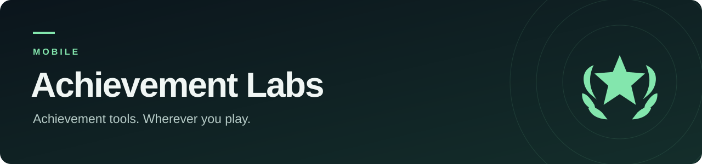
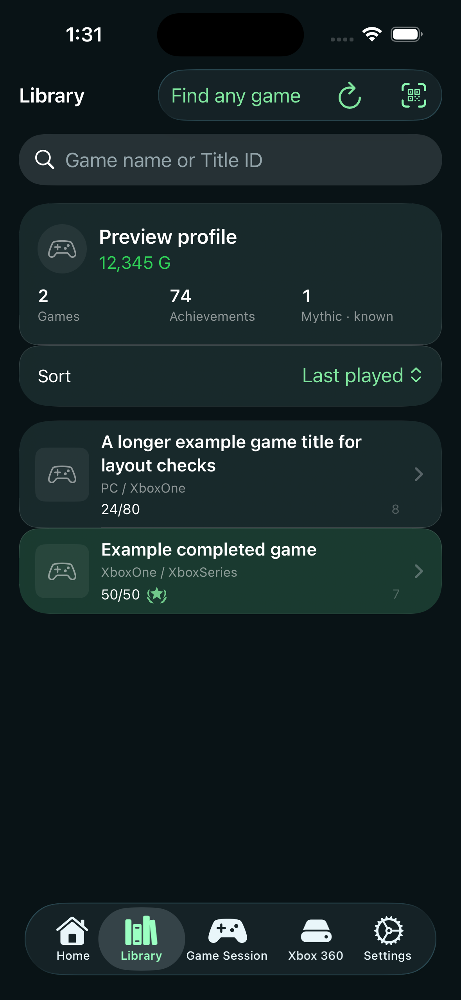
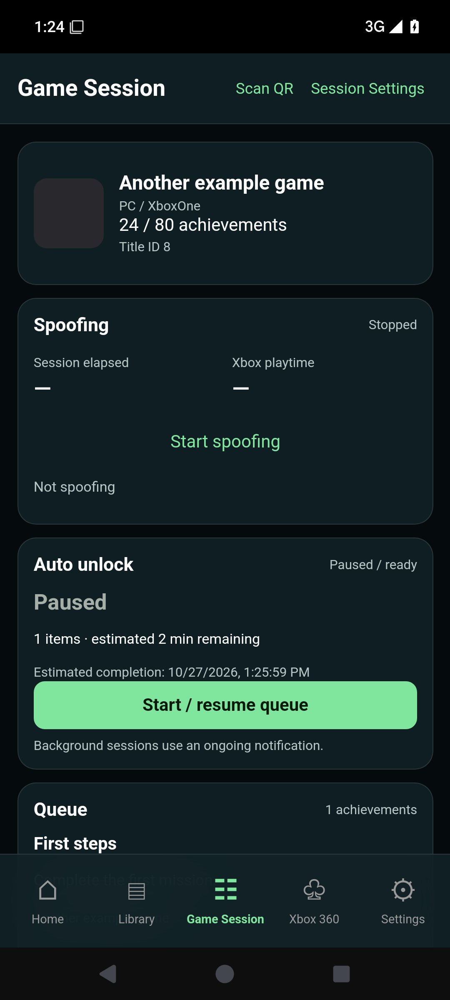
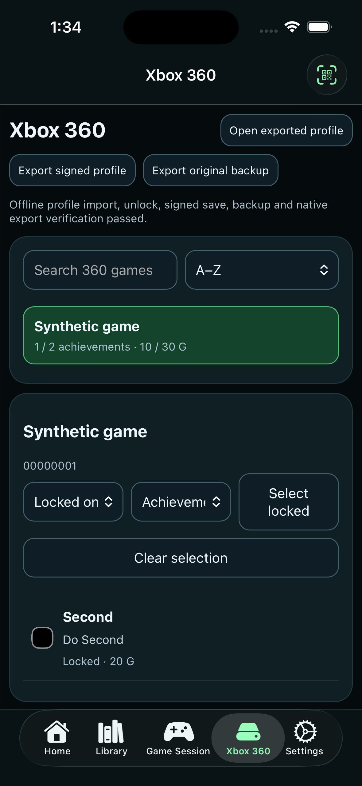

  

<h1 align="center">Achievement Labs Mobile</h1>

Achievement, progress, and profile tools for Android, iPhone, and iPad.

  
  
  

  
  

Bring Achievement Labs to your phone. Browse games and achievement progress, prepare queues with editable delays, and keep presence controls alongside your Game Session. Both apps also include an offline editor for supported exported Xbox 360 profiles.

<table>
  <tr>
    <td align="center" width="33%"></td>
    <td align="center" width="33%"></td>
    <td align="center" width="33%"></td>
  </tr>
  <tr><td><b>Browse your library</b> iPhone / iPad</td><td><b>Manage a Game Session</b> Android</td><td><b>Edit an exported profile</b> iPhone / iPad</td></tr>
</table>

*Actual simulator/emulator screenshots from offline checks, using synthetic profiles and sample data. These previews do not demonstrate live achievement credit or console synchronization.*

## Explore the apps

| Feature | What you can do |
| --- | --- |
| **Xbox library** | Search and sort games, inspect achievement progress, and spot completed titles. |
| **Game Session** | Manage title presence and Auto Unlock with explicit start/stop controls, saved queues, and editable delays. |
| **Xbox 360 profiles** | Import a supported exported profile, edit selected achievements and timestamps, keep a backup, and export a signed working copy. Console/USB copying is a separate step. |
| **Microsoft sign-in** | Connect through the supported sign-in flow described in each platform guide. |
| **Event data** | Receive supported additions from the official public event feed. Coverage and edition restrictions vary by title. |
| **Appearance and session controls** | Customize the interface and choose the session options available on your platform. Background execution depends on Android or iOS. |

## Get started

| Platform | Availability | Start here |
| --- | --- | --- |
| **Android** | Standalone beta; build instructions and CI checks | [Android build and usage](android/README.md) |
| **iPhone / iPad** | Standalone beta; iOS/iPadOS 17+; device builds require signing | [iOS build and usage](mobile/README.md) |

**This repository has no published installer releases yet.** Check the platform guides and [build workflows](https://github.com/Achievement-Labs/achievement-labs-mobile/actions) for development builds. An unsigned IPA needs your own signing/sideloading setup; an App Store or TestFlight release is not currently offered. Existing installed mobile versions keep their previous update endpoint until a migration release is provided.

Editing achievement data can carry account risk on a live service. Use test accounts and keep profile backups. Request acceptance is separate from verified Xbox progress; console acceptance and synchronization of exported profiles still require device validation. See [Xbox 360 details](docs/mobile-xbox360.md) and each platform guide for current limits.

## Join the community

- **Talk and share feedback:** [Achievement Labs Discord](https://discord.gg/EY6AJpNfVu).
- **Report a bug or request a feature:** [open a mobile issue](https://github.com/Achievement-Labs/achievement-labs-mobile/issues), including your platform, app version, and reproduction steps. Remove credentials and private profile files.
- **Contribute:** open a focused pull request against this repository's `main` branch. See the platform guides for build and validation steps.
- **Follow development:** star the repository or watch the activity that interests you.

<strong>Developer guide, repository layout, and migration</strong>

Android uses Java/WebView; iOS uses Swift/SwiftUI. The shared offline Xbox 360 editor lives in `mobile/Shared360`. Build workflows are included for both platforms.

| Path | Contents |
| --- | --- |
| `android/` | Android app and build instructions |
| `mobile/` | iOS app, shared profile editor, and resource preparation tools |
| `catalog-source/` | Unchanged upstream event snapshot and edition guards |
| `catalog/` | Title data |
| `assets/` | Shared app icon |

Run `python mobile/tools/prepare_catalogue.py` before either build. The existing pinned `prepare_360.py` download is still required for the approved shared signing resource. Follow the full [Android](android/README.md) or [iOS](mobile/README.md) instructions for remaining dependencies and signing requirements.

App update checks target this repository. Event data comes from the official public event feed. See [migration and pending contributions](docs/repository-split.md) for source provenance and release continuity.

## Credits

See the [project history and migration notes](docs/repository-split.md) for source provenance and contributor history. Existing attribution and licensing of contributed source are retained.
